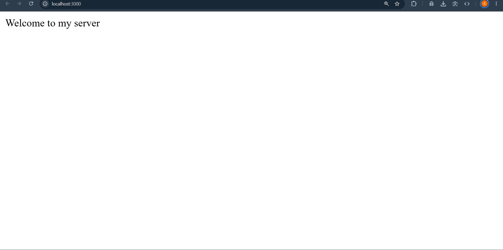
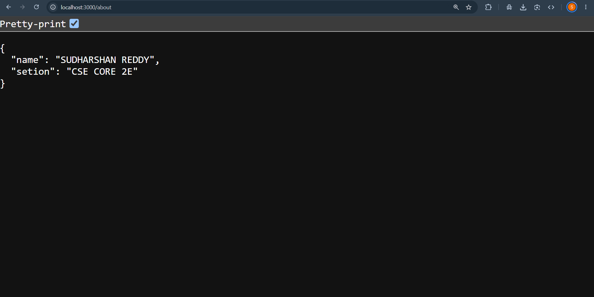
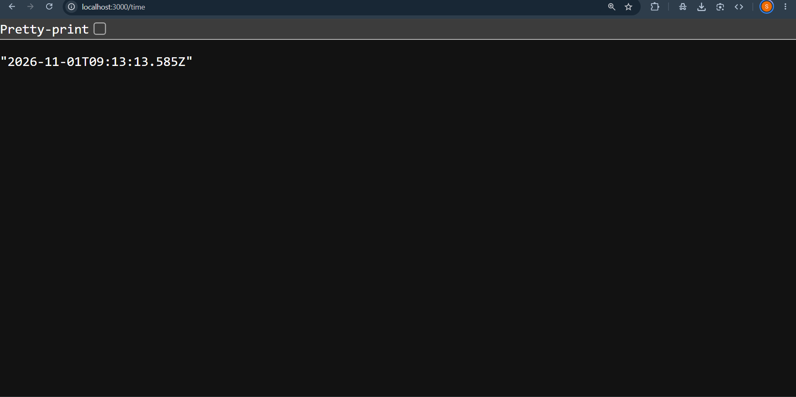

# Lab 1: Node.js and Express Server

## Lab Details

- **Lab Number:** 01
- **Subject:** Backend Development Fundamentals
- **Academic Context:** Year II, Term II
- **Module:** Node.js Basics and Express Web Server Architecture

## Student Details

- **Name:** S.S.M.Bharadwaj
- **Registration Number:** 252U1R1231
- **Section:** CSE-CORE-2E

---

## 1. Objective

The objective of this lab is to establish an isolated Node.js development environment, configure dependency management using `npm`, and construct a modular HTTP web server using Express.js. The lab demonstrates basic route definition, JSON and text response serialization, dynamic timestamp generation, and catch-all 404 error handling.

---

## 2. Technologies Used

- **Runtime:** Node.js (v18+ / v20+)
- **Framework:** Express.js (`^5.1.0`)
- **Language:** JavaScript (CommonJS `require` syntax)
- **Package Manager:** npm
- **Development Tool:** Nodemon (`^3.1.10`) for automated server restarts
- **API Testing:** VS Code REST Client (`lab-01.http`)

---

## 3. Project Structure

```text
lab-01/
├── screenshots/         # Verified route execution evidence
│   ├── 404.png          # Route not found response
│   ├── about.png        # Student metadata response
│   ├── home.png         # Root greeting response
│   └── time.png         # Server timestamp response
├── .gitignore           # Ignores node_modules, .env, and logs
├── lab-01.http          # Declarative HTTP test requests
├── package.json         # Project metadata, scripts, and dependencies
├── package-lock.json    # Deterministic dependency lockfile
├── README.md            # Lab documentation and specifications
└── server.js            # Express server implementation
```

---

## 4. Installation and Setup

### Prerequisites
- Node.js (v18.x or later installed)
- npm (v9.x or later installed)
- PowerShell or command terminal

### Installation Steps
Navigate into the `lab-01` directory and install dependencies:

```powershell
cd lab-01
npm install
```

---

## 5. Running the Application

### Development Mode (with auto-reload)
```powershell
npm run dev
```

### Production / Standard Mode
```powershell
npm start
```

The Express server listens on port **3000** by default:
```text
http://localhost:3000/
```

---

## 6. API Specifications

### Route Summary

| HTTP Method | Endpoint | Description | Content-Type | Status Code |
| :--- | :--- | :--- | :--- | :--- |
| **GET** | `/` | Welcomes user to the server | `text/html; charset=utf-8` | `200 OK` |
| **GET** | `/about` | Returns student metadata object | `application/json; charset=utf-8` | `200 OK` |
| **GET** | `/time` | Returns server timestamp string | `text/html; charset=utf-8` | `200 OK` |
| **ALL** | `/*` (Fallback) | Catch-all middleware for undefined routes | `text/html; charset=utf-8` | `404 Not Found` |

---

## 7. Request and Response Examples

### 1. Root Route
- **Request:** `GET http://localhost:3000/`
- **Response Status:** `200 OK`
- **Response Body:**
  ```text
  Welcome to my server
  ```

### 2. About Route
- **Request:** `GET http://localhost:3000/about`
- **Response Status:** `200 OK`
- **Response Body:**
  ```json
  {
    "name": "S.S.M.Bharadwaj",
    "setion": "CSE CORE 2E"
  }
  ```
  *(Note: The JSON key is implemented as `"setion"` in `server.js` line 10).*

### 3. Server Time Route
- **Request:** `GET http://localhost:3000/time`
- **Response Status:** `200 OK`
- **Response Body:**
  ```text
  2026-11-01T17:29:15.123Z
  ```

### 4. Catch-All 404 Route
- **Request:** `GET http://localhost:3000/contact` (or any undefined path)
- **Response Status:** `404 Not Found`
- **Response Body:**
  ```text
  Page not found
  ```

---

## 8. Verification Screenshots

All screenshots below represent actual verified execution results stored in the repository:

### 1. Root Route (`/`)


### 2. About Route (`/about`)


### 3. Time Route (`/time`)


### 4. 404 Fallback Route


---

## 9. Testing with REST Client

The repository includes a dedicated [`lab-01.http`](./lab-01.http) file for zero-dependency API testing using the **REST Client** extension for VS Code:

1. Open `lab-01/lab-01.http` in VS Code.
2. Ensure the server is running (`npm run dev`).
3. Click **Send Request** above any HTTP definition block.
4. Verify response headers, status codes, and body content in the preview window.

---

## 10. Technical Observations & Code Audit

- **Port Hardcoding:** In `server.js` line 19, `app.listen(3000)` is invoked with a fixed port without falling back to `process.env.PORT`.
- **Property Typo:** In `server.js` line 10, the property is defined as `setion` instead of `section`.
- **Fallback Middleware Placement:** The 404 middleware `app.use((request, response) => { response.status(404).send("Page not found") })` is correctly placed after all route definitions, ensuring proper request lifecycle flow.

---

## 11. Viva Voce Preparation

### Q1: What is the purpose of `express()` and how does it differ from the Node.js built-in `http` module?
> **Answer:** `express()` initializes an Express application wrapper on top of Node's native `http` module. It provides routing tables, middleware chaining, query string parsing, and response convenience methods (such as `res.send()` and `res.json()`), abstracting away manual chunk buffer assembly and header management.

### Q2: Why is the 404 handler placed at the end of `server.js`?
> **Answer:** Express evaluates middleware and route handlers in sequential order of registration. If the 404 middleware were declared at the top, it would intercept and terminate every incoming request before matching any specific route handler.

### Q3: What is the role of `nodemon` in development?
> **Answer:** `nodemon` is a development tool that monitors file system changes within the project directory. When a file modification is detected, it automatically restarts the Node process, removing the need for manual server termination and rebooting.

### Q4: How does `res.send()` determine the HTTP `Content-Type` header?
> **Answer:** When passed a string, `res.send()` sets `Content-Type: text/html`. When passed an object or array, it serializes the payload to JSON and sets `Content-Type: application/json`.

---

## 12. Conclusion

Lab 01 was successfully completed. An Express web server was configured and executed on port 3000, fulfilling route handling, dynamic time calculation, JSON payload responses, and fallback error handling verified via the REST Client.
